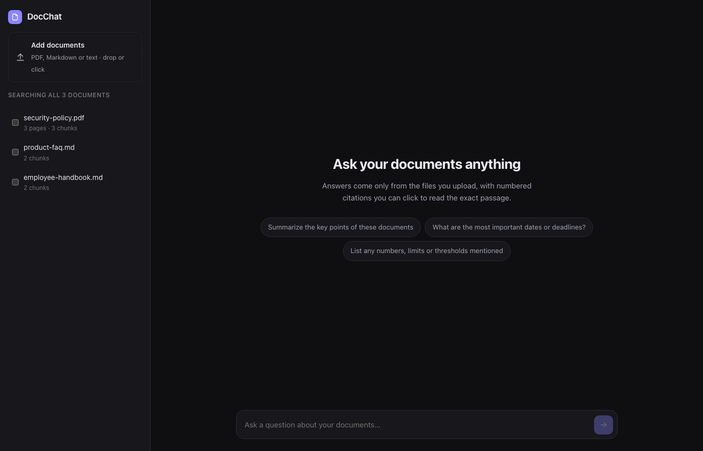
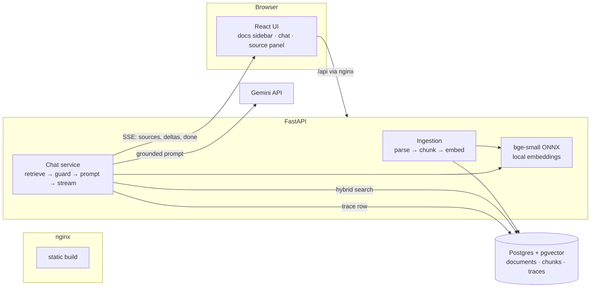

# DocChat

A small app to chat with your own documents. You upload PDFs, Markdown or plain text
files, ask questions, and the answer comes back streamed, with numbered citations. Click
a citation and you can read the exact passage the model was given. The model is told to
answer only from your documents, and if it can't find the answer there it should say so
instead of making something up.



<!-- TODO: add docs/screenshots/chat.png (an answer with citations + source panel open) once GEMINI_API_KEY is set -->

---

## Running it

You need Docker (with Compose) and a Gemini API key. You can get a key free from
<https://aistudio.google.com/apikey>.

```bash
cp .env.example .env          # put your GEMINI_API_KEY in this file
make up                       # same as: docker compose up -d --build
open http://localhost:8080
```

For some test data, drag the files in `sample_docs/` into the sidebar. There is an employee
handbook and a product FAQ for a made-up company, plus a 3-page security policy PDF.

| Command | What it does |
|---|---|
| `make test` | API unit and integration tests (against real Postgres), web tests and typecheck |
| `make lint` | ruff lint and format check |
| `make eval` | Retrieval metrics on the golden set. No LLM calls, so it's free |
| `make eval-llm` | End-to-end answer and refusal accuracy. This one calls Gemini |
| `make logs` | Tail the API's JSON logs |

If you don't set a key, the app still comes up. Upload, indexing, search and the UI all
work, and chat just shows an "answers are disabled" message. It doesn't crash.

To run it without Docker:

```bash
cd api && pip install -e ".[dev]" && uvicorn app.main:create_app --factory --reload
cd web && npm install && npm run dev      # Vite proxies /api to :8000
```

---

## How it works



### Uploading a document (`POST /api/documents`)

First the file is hashed. If the same file is uploaded again, nothing happens. PDFs are
parsed page by page with PyMuPDF. The text is then split into chunks of about 400 tokens
with a 60-token overlap, and a chunk never crosses a page boundary, so a page number in a
citation is always correct. The chunks are embedded locally and saved in a single
transaction.

### Asking a question (`POST /api/chat`, Server-Sent Events)

1. **Retrieve.** Hybrid search: pgvector cosine similarity and Postgres full-text search,
   merged using Reciprocal Rank Fusion. The top 6 chunks are taken.
2. **Guard.** If even the best chunk's similarity is below `MIN_RELEVANCE`, we reply "not
   found" and don't call the LLM at all.
3. **Prompt.** The chunks go into the prompt as numbered `<source id="n">` blocks, up to a
   token budget. The system prompt asks for citations, and it says that whatever is
   inside a source is data, not instructions.
4. **Stream.** The `sources` event is sent first so the UI can show the citations
   straightaway. After that come the `delta` tokens, and finally `done`, which carries the
   outcome, citations, token usage and timings.
5. **Check.** Citations are checked against the sources we actually sent. The outcome is
   one of `answered`, `uncited`, `model_declined`, `no_relevant_context` or `error`.
6. **Trace.** Every request writes one row to `query_traces`, with the retrieved chunk
   IDs and scores, the answer, tokens and the latency of each stage.

### Where things are

```
api/app/
  ingest/      parsers.py · chunker.py · embedder.py · service.py
  retrieval/   retriever.py
  generation/  prompts.py · guardrails.py · llm.py (Gemini + FakeLLM)
  chat.py      the RAG flow, as a stream of events
  store.py     all the SQL (documents, hybrid search, traces)
  main.py      app factory, request-id logging middleware
api/tests/     unit tests + integration tests against real Postgres
web/src/       React app (Vite, TypeScript, no UI framework)
evals/         golden_set.jsonl + run_evals.py
sample_docs/   made-up sample documents
```

---

## Choices I made, and why

| What | I went with | Other options | Reason |
|---|---|---|---|
| LLM | **Gemini 3.8 Flash** (`LLM_MODEL`), `thinking_level=low` | Gemini Pro, Claude, GPT, local Llama | Time to first token matters a lot in a chat UI, and grounded Q&A doesn't need much reasoning. Changing the model is a single env variable. |
| Embeddings | **BAAI/bge-small-en-v1.5** via fastembed (ONNX, CPU, 384-d) | `gemini-embedding-001`, OpenAI `text-embedding-3-small` | No key, no per-token cost, and documents never leave the machine. The model is baked into the image. The catch is that it's English only. |
| Vector store | **Postgres + pgvector** (HNSW) | Chroma, Qdrant, Pinecone | One database holds documents, vectors, full-text search and traces. Ingest is transactional, and every cloud has managed Postgres. |
| Retrieval | **Dense + full-text, fused with RRF (k=60)** | Dense only, or dense + cross-encoder reranker | Embeddings are bad at exact tokens like codes, names and numbers, and full-text search is good at them. RRF doesn't need the two scores to be calibrated. |
| Chunking | Recursive (paragraph → line → sentence → word), 400 tokens, 60 overlap, per page | Fixed size, semantic chunking, whole sections | It follows the document's structure, page citations stay exact, and the overlap saves facts that fall on a boundary. |
| Orchestration | **None, just Python** (about 150 lines in `chat.py`) | LangChain, LlamaIndex | I wanted to be able to see, test and debug every step. The flow is linear, so a framework would only add indirection. |
| Citations | Numbered sources in the prompt, validated on the server | Provider's own grounding/citation APIs | It doesn't depend on one provider, and we can check the citations and flag wrong or missing ones. |

### Prompt and context

- The system prompt has a list of rules: answer only from the sources, cite as `[n]`, use
  an exact "not found" phrase, say what is missing when the answer is partial, and treat
  source text as data, not instructions.
- Sources are added in rank order until `MAX_CONTEXT_TOKENS` (6k) is used up. A chunk is
  either included fully or dropped, never cut off in the middle.
- History is the last 6 turns, normalised so the roles strictly alternate. For retrieval, I
  prefix a follow-up question with the previous user question, because something like
  "what about part-time?" means nothing on its own. History is never treated as a source
  of facts.
- The filename is added to the chunk text only at embedding time. It's a cheap way of
  giving each chunk some context.

### Guardrails

- **Input:** empty or very long questions get a 422. Uploads are checked for type, size
  and whether there is any text to extract.
- **Retrieval gate:** if no chunk is above `MIN_RELEVANCE`, the reply is "not found" and
  **the LLM is not called**.
- **Prompt injection:** source content sits inside tags, any `</source>` inside a document
  is neutralised, and the model is told to ignore instructions it finds in sources.
- **Output:** citations are checked against the sources that were sent. Uncited answers
  get a warning banner in the UI, and invalid citation numbers are reported in `done` and
  logged.

### Measuring quality

I didn't want to tune anything by gut feeling, so there is a small golden set: 24
answerable questions and 4 unanswerable ones. `make eval` gives:

| Metric | Result |
|---|---|
| Retrieval hit@6 | 1.00 |
| Retrieval hit@1 | 0.92 |
| MRR | 0.96 |

The same run is how I picked the relevance threshold. Answerable questions had a top
similarity of 0.55 or more, and off-topic ones were between 0.41 and 0.46. At 0.55, one
real question would only just have got through, so I brought `MIN_RELEVANCE` down to
**0.50**. In-domain questions that can't be answered (for example "Who is the CEO?", which
scores 0.57–0.61) can't be told apart by similarity alone. Those go to the LLM, which is
instructed to decline, and `make eval-llm` measures whether it actually does.

*To be honest, the sample corpus is tiny (7 chunks), so treat these numbers as a smoke
test, not a benchmark.*

### Observability

- JSON logs carry a request ID. It starts at nginx (`X-Request-Id`) and goes all the way
  through to LLM errors.
- One trace row per request: retrieved chunks and scores, outcome, tokens, and retrieval,
  first-token and total latency. You can see these at `GET /api/traces`, and the
  **Details** toggle in the UI shows the same data for each answer.
- If writing a trace fails, the user's request still goes through.

---

## Taking this to production (AWS as the example)

| Area | Now | In production |
|---|---|---|
| Compute | Docker Compose | API on ECS Fargate (or Cloud Run / Container Apps) behind an ALB, autoscaled on CPU and concurrent streams. Static UI on S3 + CloudFront. |
| Database | Postgres container | RDS/Aurora Postgres with pgvector, Multi-AZ, PITR backups, pgBouncer/RDS Proxy. A separate read replica for search at scale. |
| Ingestion | Synchronous, inside the request | Upload to S3 (presigned URL) → SQS → worker service. Document status in the DB (`pending → indexed/failed`), retries and a dead-letter queue. Textract OCR for scanned PDFs. |
| Embeddings | CPU, in the API process | A separate embedding worker or a managed endpoint, so bulk ingestion doesn't slow down queries. |
| Tenancy and auth | None (single user) | OIDC (Cognito/Auth0). `tenant_id` on every row with Postgres row-level security, and per-tenant retrieval filters. |
| Secrets | `.env` | Secrets Manager / SSM, injected at runtime, with key rotation. |
| LLM | Gemini API directly | Vertex AI (VPC-SC, data residency, quotas). Retries with backoff, a fallback model, per-tenant rate limits and cost budgets, and caching for repeated questions. |
| Observability | JSON logs + trace table | OpenTelemetry → CloudWatch/X-Ray or Datadog, an LLM tracing tool (Langfuse/Phoenix), dashboards for latency, refusal rate, uncited rate, tokens and cost, and alerts. |
| Quality | Offline golden set | Eval set runs in CI on every retrieval or prompt change. 👍/👎 feedback on answers, and sampled LLM-as-judge faithfulness scoring on production traces. |
| Delivery | Local | IaC (Terraform/CDK), CI/CD with migrations (Alembic), staged environments, blue/green deploys. |

Once the corpus gets really big (tens of millions of chunks), I would look again at
whether pgvector is still the right fit, and probably move to something dedicated like
OpenSearch k-NN, Qdrant or Vertex Vector Search, with a cross-encoder reranker over a
wider set of candidates.

---

## The main decisions, in short

1. **A plain pipeline I can read, not a framework.** The whole RAG flow fits on one
   screen (`chat.py`), and each stage has unit tests with fakes.
2. **Refuse before generating.** The cheapest way to avoid a hallucination is to not ask
   the model when retrieval found nothing useful. The threshold came from eval data.
3. **One datastore.** Postgres keeps documents, vectors, full-text indexes and traces.
   Fewer moving parts, transactional ingest, cascade deletes.
4. **Local embeddings.** No cost, private by default, and reproducible. Moving to an API
   model means writing one class behind the `Embedder` protocol.
5. **Send sources first.** The UI shows *what the answer is based on* before the answer
   arrives.
6. **Fail politely.** A missing API key, a provider outage or a failed trace write each
   give a clear message instead of a crash.

## Engineering standards

**What I followed**
- Typed Python (dataclasses/Pydantic) and strict TypeScript, with ruff for lint and format.
- Dependency injection through small Protocols (`Embedder`, `LLM`, `Retriever`,
  `TraceSink`). Tests use fakes, and no test goes to the network.
- Tests for the chunker, parsers, prompts, guardrails and chat service, plus API
  integration tests against real Postgres + pgvector. That's 32 Python tests and 4 web
  tests.
- All SQL is in one module, and every query is parameterised.
- 12-factor config from env variables with documented defaults. Containers have
  healthchecks, run as a non-root user, and the model is baked into the image.
- CI on GitHub Actions: lint, tests with a pgvector service container, and the web build.

**What I left out for now**
- Auth, multi-tenancy and rate limiting.
- A migration tool. One idempotent SQL file is enough until the schema changes.
- Async ingestion queue, OCR, DOCX/HTML parsing.
- Frontend component tests (only the SSE parser and citation linking are tested).
- Load testing.

## How I used AI tools

- I built this with Claude Code. We discussed the architecture and stack first, then
  generated it module by module, running tests and lint after every step.
- `CLAUDE.md` has the repo's conventions (where SQL lives, fakes in tests, run evals after
  retrieval changes), so any AI assistant writes code that fits.
- Halfway through I switched the LLM provider from Claude to Gemini. Because of the `LLM`
  protocol, only one file had to change.
- I didn't just trust the output. SDK calls were checked against the installed package,
  and the relevance threshold was changed based on the eval output, not a guess.

<!-- Add your own do's and don'ts for working with AI tools here. -->

## If I had more time

- A cross-encoder reranker (say `bge-reranker-base`) and a bigger, harder eval set. Then
  I'd sweep chunk size and top-k against it.
- Async ingestion with progress, OCR for scanned PDFs, DOCX/HTML support.
- LLM-as-judge faithfulness scoring in `make eval-llm`, and 👍/👎 feedback in the UI
  stored with the traces.
- Use the LLM to rewrite follow-up questions, instead of the "prepend the previous
  question" trick.
- Highlight the cited sentence inside the source panel, and open the PDF on the right page.
- Auth and per-user document isolation.

## Known limitations

- Embeddings and full-text search are English only.
- Scanned (image-only) PDFs are rejected because there is no OCR.
- Chunks don't cross pages, so a paragraph that runs over two PDF pages gets split.
- Tables in PDFs come out as plain text, so the layout is lost.
- Ingestion is synchronous, so a very large PDF holds up that request for a few seconds.
- The answer-level evals (`make eval-llm`) need a Gemini key and haven't been run on this
  repo yet.
